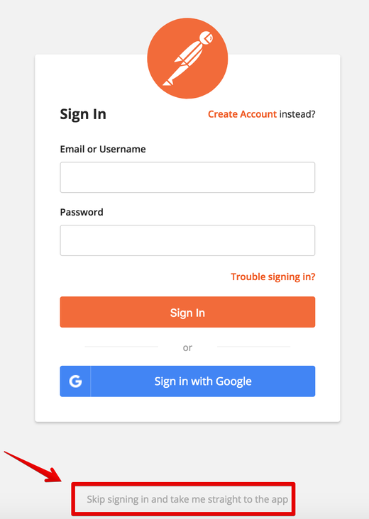
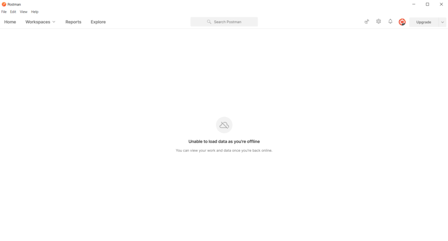
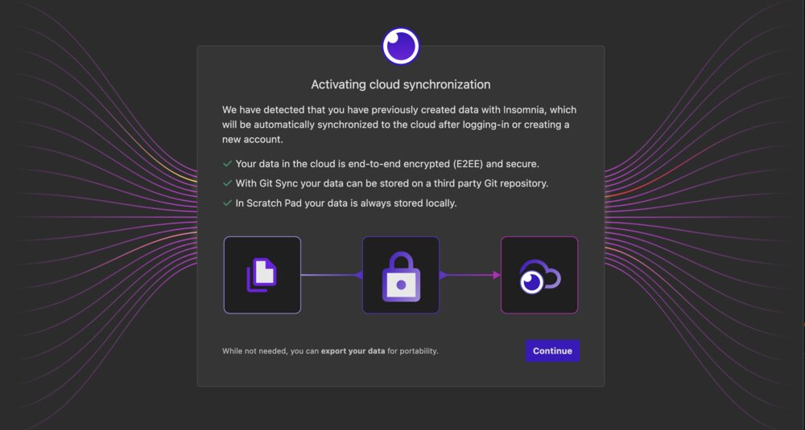
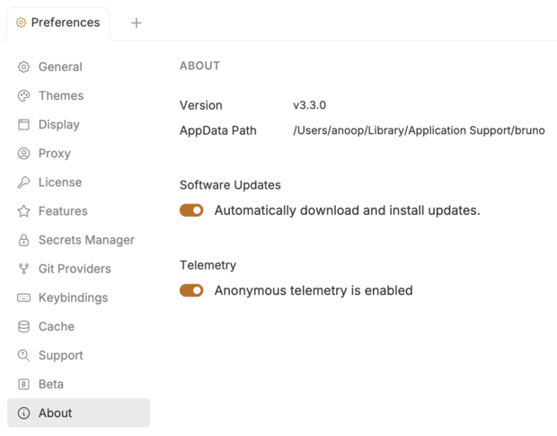
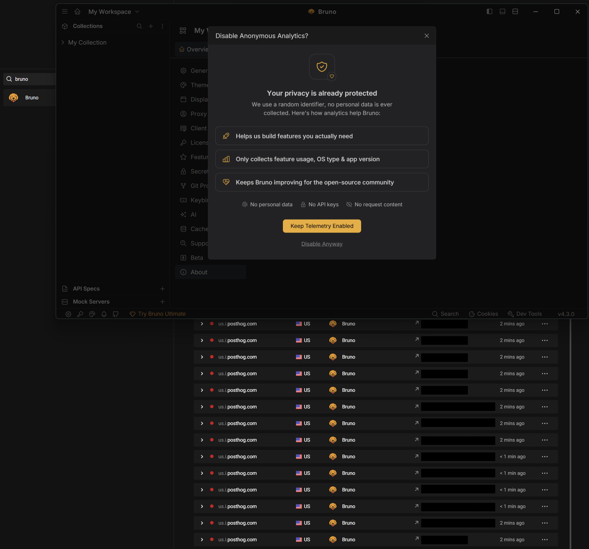
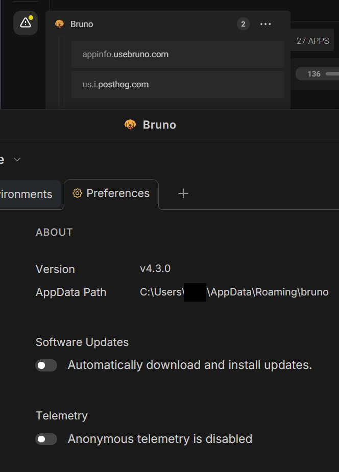

During my second ever job, I was working for a serious client. The client was a bank. One day I opened Postman and found myself locked out behind an account screen, with a tiny, easy-to-miss link to skip it. I eventually got my stuff back, but the experience stuck with me.

It was the first time a tool I used professionally had pulled something like this, but it wouldn't be the last. I have 2 "fell for it again" awards, and the second stung more because it was from an open-source project.

This article follows API clients: Postman, Insomnia, Insomnium and Bruno, in roughly the order I came across them, and explains why I eventually decided to de-enshittify one of them for my own use. That project is [restless](https://github.com/outmanos/restless) ([site](https://restless.outmanos.com)), an independent, offline-first fork of Insomnia inspired by Insomnium. Obviously, I have a stake in how this story ends, so keep that in mind while reading.

Also, apologies in advance for how much Hacker News is going to feature in this post. I'm a chronic HN browser. Hopefully some of you can relate. You know, the alone coffee break, or that first coffee in the morning after checking your emails and inevitably ending up on HN.

I also further apologize for the upcoming silly chapter names, the first one of which should be read like the title of a 70s tokusatsu show.

## Chapter 1: The Highly Valuable But Barely Usable Postman

In March 2020, someone asked the Postman community [how to skip account creation](https://community.postman.com/t/how-to-skip-account-creation/11469). The answer was a "Skip signing in" link. This is the screenshot posted in reply, arrow included:


*The way out in March 2020. The red box and arrow are from [the original reply](https://community.postman.com/t/how-to-skip-account-creation/11469) (by Postman community user Kurmavatar).*

That was a bit of a wake-up call. This was supposed to be a modern industry-standard tool, yet it was already moving in a direction that didn't sit right with me. I didn't like the idea of handing over my data, let alone my client's, to a service that could potentially lock me out of it whenever it wanted. And eventually, that's exactly what would have happened to me had I not jumped ship.

In January 2021, version 8 left some users staring at ["Unable to load data as you're offline"](https://github.com/postmanlabs/postman-app-support/issues/9481). In a related issue, a Postman representative asked a user whether their old collections were ["in the scratch pad view"](https://github.com/postmanlabs/postman-app-support/issues/9487#issuecomment-770241333).


*An API client refusing to show your data because you're offline. [Reported in January 2021](https://github.com/postmanlabs/postman-app-support/issues/9481) (by GitHub user qqk1011).*

Then came the end of the Scratch Pad, at the time Postman's remaining offline mode.

On May 14, 2023, Postman's CEO [announced its retirement](https://blog.postman.com/announcing-new-lightweight-postman-api-client/). His explanation was that maintaining both the Scratch Pad and cloud workspaces meant ["2x-4x the amount of time"](https://blog.postman.com/announcing-new-lightweight-postman-api-client/) spent on development. So it was time to ["announce the end for offline capabilities"](https://blog.postman.com/announcing-new-lightweight-postman-api-client/).

The replacement still stores data locally, according to Postman, but collections and environments require signing in. And if you wanted to recover your old data, ["You must migrate your data to a Postman account"](https://blog.postman.com/announcing-new-lightweight-postman-api-client/).

A few months later, in October 2023, a [Tell HN post](https://news.ycombinator.com/item?id=37792690) with 365 points described what happened when its author declined to create an account: ["it wiped all my collections and everything else"](https://news.ycombinator.com/item?id=37792690).

It is worth looking at where Postman was financially around this time. It started, in its CEO's words, as ["a tiny Chrome extension to send API calls"](https://blog.postman.com/announcing-new-lightweight-postman-api-client/). In June 2020, it [raised $150M at a $2B valuation](https://techcrunch.com/2020/06/11/api-platform-postman-nabs-150m-series-c-on-2b-valuation/). In August 2021, it closed another round of ["$225 million that values the company at $5.6 billion"](https://blog.postman.com/postman-announces-series-d/).

Bruno's creator, Anoop M D, included Postman in a table in his [long-term vision thread](https://github.com/usebruno/bruno/discussions/269), which Bruno's README links to. His figures were ["$434M, $5.6B Valuation"](https://github.com/usebruno/bruno/discussions/269). Asked about it on HN, he replied: ["But yes $5.6b is nuts."](https://news.ycombinator.com/item?id=37730002)

Postman has its own side of the story. During the AWS outage in October 2025, Postman went down for people who thought they were using it locally. The [Hacker News discussion](https://news.ycombinator.com/item?id=45645172) reached 537 points. Someone introducing himself as Postman's founder joined the discussion and explained that the decision to build sign-in and cloud features was ["not due to a VC-led conspiracy"](https://news.ycombinator.com/item?id=45652555). Customers had asked for those features, he said, and an offline client for sending requests still exists.

And then there's the latest mess: Just last week as of the writing of this post, a [GitHub issue](https://github.com/postmanlabs/postman-app-support/issues/14370) reports that opening Postman 12.33.4 on macOS installed plugins into Claude Code and Codex, modified their configurations and attempted to approve its own startup hook.

The [Hacker News thread](https://news.ycombinator.com/item?id=50354960) has almost 1,500 points, with a title claiming Postman ["attempts to share all API data"](https://news.ycombinator.com/item?id=50354960). There's an important distinction here: the issue itself explicitly says ["it does not claim to establish data exfiltration"](https://github.com/postmanlabs/postman-app-support/issues/14370).

Postman's head of product responded through a PR agency. As paraphrased by [RuntimeWire](https://runtimewire.com/article/postmans-head-of-product-says-it-will-make-ai-agent-plugin-o-7933b7), Postman bundles its CLI and plugins to make setup easier, plans to make the opt-in clearer for existing users, and is reviewing the hook behavior.

I couldn't find a fix or a date for one.

Also, just as a sidenote, using GitHub for a closed-source project always felt wrong to me, it feels inherently misleading. I don't know.

## Chapter 2: Losing sleep over Insomnia

I discovered Insomnia because people were complaining about Postman. I switched over and was happy with it. I used it through COVID and for quite a while afterwards, until one day it locked me out of my stuff too.

Most of my data was backed up, thankfully, but I still had to redo a lot of requests because I refused to create an account. It was terrible, especially given what else was going on in my life at the time. Not to show my age again but I actually lost sleep over it.

This happened on September 27, 2023, when [Insomnia 8.0 shipped](https://insomnia.rest/changelog) and put projects behind an account.

Kong had acquired Insomnia in 2019. At the time, Insomnia had grown from a Chrome web app into a desktop application. Kong said ["we will be maintaining Insomnia as an open source project"](https://konghq.com/blog/kong-acquires-insomnia) and assured users that the deal ["will not lead to disruption for existing Insomnia users"](https://konghq.com/blog/kong-acquires-insomnia).

Disruption did indeed occur to me and ostensibly many, many others.

Opening HN I found a thread titled ["Insomnia REST client now requires an account"](https://news.ycombinator.com/item?id=37680126) on the front page. (Another thread, ["Insomnia's update locks out prev user data, forces account creation w/o warning"](https://news.ycombinator.com/item?id=37680522), was merged into it.)

One commenter described it as ["the sort of thing you don't roll out in an automatic update"](https://news.ycombinator.com/item?id=37681260). Another suggested ["we need a Vscodium for Insomnia"](https://news.ycombinator.com/item?id=37681474). The first reply was simply ["Insomnium?"](https://news.ycombinator.com/item?id=37684202) (foreshadowing). Someone else suggested ["Bruno maybe?"](https://news.ycombinator.com/item?id=37680871).


*The onboarding screen, as [posted by Kong's CTO](https://github.com/Kong/insomnia/issues/6577#issuecomment-1738023534) (GitHub user subnetmarco) during the backlash.*

Kong's CTO joined the discussion and tried to explain what was happening. He pointed out that older versions still worked locally, that the Scratch Pad didn't require an account, and that an onboarding step explained the changes and offered an export. He also said [nothing was migrated until you created an account](https://news.ycombinator.com/item?id=37683704).

On GitHub, he gave three reasons for the change: collaboration required cloud infrastructure, maintaining two storage backends was becoming a burden, and ["we need a viable business"](https://github.com/Kong/insomnia/issues/6577#issuecomment-1738131554).

He also acknowledged that ["this was an oversight"](https://github.com/Kong/insomnia/issues/6577#issuecomment-1738131554) when it came to explaining how users could export their data.

Kong did fix some of the problems within days. On October 16, it [brought back local projects](https://github.com/Kong/insomnia/discussions/6626) in version 8.3, describing their removal as ["a faulty assumption"](https://github.com/Kong/insomnia/discussions/6626).

There was still a catch: ["You will need an account with Local Vault"](https://github.com/Kong/insomnia/discussions/6626). At least the account could be free.

To me and many others, the damage was done. And trust can't be so easily regained in my opinion. Especially with all the money involved that influences the incentive structure. It's hard to see this as an honest mistake.

## Chapter 3: I like VS Codium, so... Insomnium?

Back to that HN discussion. Somewhere in the comments was a one-word suggestion: [Insomnium?](https://news.ycombinator.com/item?id=37684202)

I downloaded it immediately and have been using it ever since. It's still installed on my Windows PC, and I still use it regularly.

Insomnium was a fork of Insomnia 2023.5.8, ["the last commit before compulsory account login was introduced"](https://github.com/outmanos/restless/blob/main/docs/insomnium/README.md). The login and tracking were removed.

Its author announced it on [Hacker News](https://news.ycombinator.com/item?id=37708582) on September 29, 2023, where it got 204 points. When someone asked whether he planned to maintain it, he answered ["Yes! I plan to maintain it long-term!"](https://news.ycombinator.com/item?id=37714112).

In July 2024, the repository was archived with a note saying it was ["no longer being actively maintained"](https://news.ycombinator.com/item?id=41128221). The note pointed to a related project but didn't name it.

To be fair, Insomnium was essentially a snapshot of one particular Insomnia version, with the account requirements removed, some privacy improvements and a few tweaks for the LLMs that were starting to become popular. It wasn't a completely independent application with its own development direction.

Eventually, I wanted to fork it myself and bring its dependencies up to date. The main concern was security, particularly Electron, but also the Node/React/Vite ecosystem around it. The webslop, if you will. Running an old Electron application with a mountain of known vulnerabilities that for a lot of cases has to be connected to the internet to function is not something I particularly enjoy nor recommend. And as any webdev would know, that's not really an exaggeration: running `npm audit` today on Insomnium's September 2023 lockfile, which pins Electron 25.2.0, reports 127 vulnerabilities, 16 of them critical and 77 high.

But when I went looking for the original repository, it was gone.

I don't know what happened to it. I couldn't find anyone explaining its disappearance either.

The only clue I found was the description of a repository recreated under the same name on November 3, 2026, by a new organization that also calls itself ArchGPT. As far as I remember, it's the same creator, but I can't prove that. The description reads ["restored repo after accidental deletion in an automated workflow"](https://github.com/ArchGPT/insomnium).

It doesn't mention an AI agent, although its single commit is authored by "archgpt-agent-0". The repository contains a single ZIP file, which I haven't opened and would treat as untrusted.

Thankfully, the Internet Archive still has [a copy of the original source from October 2023](https://archive.org/details/github.com-ArchGPT-insomnium_-_2023-10-05_17-09-14).

Still, losing access to the original repository felt strangely bad. Almost like finding out that some obscure piece of software had become "lost media". It's probably irrational, considering the number of forks, but that's how it felt. Apparently someone has been running a continuation, [yokomohoyo/insomnium](https://github.com/yokomohoyo/insomnium), since June 2026, and its README says it's actively maintained. I haven't tried it yet.

One personal takeaway: a repository disappearing like this is another reason nobody should give AI agents unrestricted control over their machines, or accounts. No matter how convenient it might be.

## Chapter 4: Let's address the dog in the room

I tried Bruno in late September 2023, around the time of [this Hacker News thread](https://news.ycombinator.com/item?id=37697206).

It had telemetry enabled by default, which bothered me, particularly given the promises being made around privacy and offline use. I also had my gripes with Electronslop, like the commenters there, although I realize that's a bit hypocritical when Insomnia itself is pretty terribly bloated. If I had the time to redo restless in something like Rust, I would.

I kept Bruno installed, but never felt like using it.

Bruno was created by Anoop M D and [open-sourced under the MIT license in October 2022](https://github.com/usebruno/bruno/discussions/269). It was also [posted to Hacker News](https://news.ycombinator.com/item?id=33241941) that month.

One of its main selling points is that collections are stored as ordinary files, which you can version-control with Git.

About the telemetry issue, here's what I could verify:

Since [October 30, 2022](https://github.com/usebruno/bruno/commit/f283df2a1b6784d6f19af7b01b680e2062590521), Bruno has sent an anonymous ping to PostHog at startup and once a day afterwards. The data includes a random ID and the operating system, with its version added later. The code describes it as ["just an anonymous visit counter"](https://github.com/usebruno/bruno/blob/main/packages/bruno-app/src/providers/App/useTelemetry.js).

The offline promises came after.

At launch, the README listed an ["Open source Sync Server"](https://github.com/usebruno/bruno/blob/0f5b75ddbf1509b36642235f8de88d931d48324b/readme.md). The statement ["Bruno is offline-only. There are no plans to add cloud-sync to Bruno, ever."](https://github.com/usebruno/bruno/blob/main/readme.md) was added on October 2, 2023, in [this commit](https://github.com/usebruno/bruno/commit/ce0827308f621c9aa0c530db24aa8ba84f7976c1).

Anoop also described Bruno as ["Fully offline"](https://news.ycombinator.com/item?id=37688239) in a Hacker News comment. A reader wasn't convinced. They replied: ["There is telemetry. And I didn't find opt in or even opt out code."](https://news.ycombinator.com/item?id=37697206). Anoop called the telemetry ["miniscule"](https://news.ycombinator.com/item?id=37700254) and promised an off switch. On October 4, 2023, he wrote ["Just give me a couple of days time."](https://github.com/usebruno/bruno/issues/337#issuecomment-1746591000). He also clarified what he meant by offline-only: ["there will never be an online sync or cloud sync for api collections"](https://github.com/usebruno/bruno/issues/337#issuecomment-1746591000).

The exchange I remember most happened two days later, on October 6, 2023, under the Tell HN post about Postman wiping people's collections. Anoop [promoted Bruno](https://news.ycombinator.com/item?id=37797811), repeating ["No cloud sync. Fully offline."](https://news.ycombinator.com/item?id=37797811). Then, in another comment, he compared the API client world to the TV series Dark: ["It's a cycle."](https://news.ycombinator.com/item?id=37797886). He followed it with ["This shit has to stop."](https://news.ycombinator.com/item?id=37797886) and ["An API Client need not be VC funded."](https://news.ycombinator.com/item?id=37797886).

Someone replied directly to the offline claim:
["Fully offline is a lie. There is telemetry with no opt out."](https://news.ycombinator.com/item?id=37811913). Anoop answered that ["We will soon add support for disabling telemetry"](https://news.ycombinator.com/item?id=37816948).

The commenter wasn't having it:

>["Fully offline means fully offline."](https://news.ycombinator.com/item?id=37824688)

And frankly, I agree.

If an application claims to be fully offline but phones home every day without giving you a way to stop it, I don't think calling it offline is particularly honest. It doesn't matter much whether the ping is anonymous or how little data it sends. The network connection is still there.

When I use a program, I don't care if its maker needs to know how many active users they have, even if all it takes is a simple ping. That's irrelevant to me. The contract should be between the user and the program, not with its maker.

It also took considerably longer than the promised couple of days to get that switch.

Two and a half years later, on April 22, 2026, Anoop [announced](https://github.com/usebruno/bruno/issues/337#issuecomment-4297215975) that telemetry opt-out was finally shipping in version 3.3.0.

Someone [replied](https://github.com/usebruno/bruno/issues/337#issuecomment-4297513609) with what was probably the most appropriate response:


*[Posted on the issue](https://github.com/usebruno/bruno/issues/337#issuecomment-4297513609) (by GitHub user a-n-d-r).*

The next day, Anoop [confirmed that it was live](https://github.com/usebruno/bruno/issues/337#issuecomment-4303703779), and the issue was closed.

There is one detail worth noting in his own screenshot:


*Bruno 3.3.0, [as posted by Anoop](https://github.com/usebruno/bruno/issues/337#issuecomment-4303703779) (GitHub user helloanoop).*

Telemetry is still enabled by default.

And even then, the story apparently wasn't over. In August, someone reported ["It is still calling posthog on 3.4.2 :/"](https://github.com/usebruno/bruno/issues/337#issuecomment-5255883016).

In October, another user reported that ["Bruno 4.2.1 still generates network traffic on start-up even with the telemetry turned off."](https://github.com/usebruno/bruno/issues/337#issuecomment-6078721853). They called it ["a very dishonest approach"](https://github.com/usebruno/bruno/issues/337#issuecomment-6078721853) for software that prides itself on being offline-only.

Two days later, someone else said that even with software updates and telemetry disabled, Bruno still tried to connect to `us.i.posthog.com` and `appinfo.usebruno.com`. They [blocked both connections](https://github.com/usebruno/bruno/issues/337#issuecomment-6111949922).

I can't tell you what those connections contain. I also couldn't find the code implementing the toggle in the public source, so I can't independently confirm how it behaves.

For what it's worth, my latest installed copy is version 3.2.2, which predates the opt-out switch.

When I launched it while preparing this post, my firewall recorded the following shortly after startup:

```text
direction: outbound
domain:    us.i.posthog.com
started:   2026-11-05T02:05:18Z
allowed:   true
```

#### Quick update

I launched Bruno today, and it managed to download its latest update with the telemetry toggle.

So, a few thoughts:

I'm less pissy about the prominent and colorful "💎 Try Bruno Ultimate" link at the bottom of the window, but when I hover over it, a tooltip reads "No Credit Card Required" and that just takes me back to the 2000s era of vaporware... Weird. And I'm not saying that developers shouldn't ask for donations or have these sorts of income streams, but what I am saying is that I'm more willing to support projects that aren't so obnoxiously in-your-face about it.

What I'm really upset about is that this is what I got when I tried to turn off telemetry:


*Bruno 4.3.0's telemetry modal on top of Portmaster's connection log (my screenshot, November 5, 2026).*

Unlike the update toggle, which I can freely untoggle without Bruno begging me to reconsider because "security vulnerabilities!" "Please stay safe and up-to-date!" (more valid concerns for this kind of app, in my opinion), this one has a whole designed modal that begs you to stay. So not only is it opt-out, it's a four-click opt-out. Wunderbar.

You can see at the bottom of the screenshot some of the requests from a single launch, as recorded by Portmaster. 64 total connection attempts. It reaaaaaaally wants to send that telemetry. They really want to show the world that [4M people](https://www.usebruno.com) are using the app!!

I untoggled both updates and telemetry, closed the app, deleted its profile entirely from Portmaster, then relaunched it, and it was still trying to send requests:


*The same domains after turning both off (my screenshot, November 5, 2026).*

So I can corroborate user complaints on even the latest version of the app, v4.3.0 as of the writing of this post.

I have a feeling that the people behind Bruno are borrowing from [the book of Sony](https://consumerrights.wiki/w/Sony_PlayStation_digital_game_ownership_lawsuit) by redefining terms like offline and telemetry.

Now telemetry aside, what came next was the funding.

To be precise, Anoop didn't initially promise that Bruno would never accept any money. In his [long-term vision post](https://github.com/usebruno/bruno/discussions/269), published on October 1, 2023, the list of things he didn't want to do began with ["We don't want to raise VC funding"](https://github.com/usebruno/bruno/discussions/269).

But the same post also included an important qualification: ["I am open to changing my mind."](https://github.com/usebruno/bruno/discussions/269)

A week later, he [explained that he wanted to earn an income](https://github.com/usebruno/bruno/discussions/269#discussioncomment-7221852), mentioning a paid Golden Edition, sponsorships and merchandise as possible ways to do it.

In December 2023, he wrote ["I have chosen not to explore raising money for Bruno"](https://github.com/usebruno/bruno/discussions/269).

By March 2024, the language was much stronger. In a Hacker News thread that reached 1,538 points, he wrote ["We will never take VC funding."](https://news.ycombinator.com/item?id=39654743) and ["We are fully bootstrapped and independent."](https://news.ycombinator.com/item?id=39656680).

Someone in the discussion described the exact cycle this post is about. Anoop answered: ["Having seen 10 years of this cycle, its enough."](https://news.ycombinator.com/item?id=39656680)

Fast-forward to August 11, 2026.

Bruno published a post titled [The funding announcement we never made](https://blog.usebruno.com/the-funding-announcement-we-never-made), revealing that ["Bruno raised $3M, and we didn't announce it at the time"](https://blog.usebruno.com/the-funding-announcement-we-never-made). The investment had happened roughly a year earlier.

The investor was Silverton Partners, which Wikipedia describes as ["an early-stage venture capital firm"](https://en.wikipedia.org/wiki/Silverton_Partners).

Anoop also published [a personal explanation](https://www.helloanoop.com/blog/i-said-id-never-do-this), where he revisited his earlier statements, including ["no company, no hires, no funding, no subscriptions. Solo, forever."](https://www.helloanoop.com/blog/i-said-id-never-do-this).

He admitted ["It was naive of me to make those claims"](https://www.helloanoop.com/blog/i-said-id-never-do-this) and apologized.

Back in the original discussion, he also confirmed: ["We ended up raising funding."](https://github.com/usebruno/bruno/discussions/269#discussioncomment-17977515)

His defense is that he [retains enough voting power to control the board](https://github.com/usebruno/bruno/discussions/269#discussioncomment-17992531). Bruno also points out that it hasn't moved features behind a paywall since the funding round, and has actually made several previously paid features free, including gRPC and WebSocket support.

The homepage still says ["No cloud sync. No account. No login."](https://www.usebruno.com).

I couldn't independently verify the board arrangements, the terms of the investment or its exact closing date.

I consider this the second broken promise. And by now, the pattern was becoming rather familiar... My initial cynicism saved me from a third award! Not that feeling vindicated about this feels any good. I wish it wasn't the case, as Bruno looks rather pretty, for the most part (see my vaporware comment).

That slight tangent aside, I wasn't the only one who noticed. A Hacker News commenter pointed out that Bruno was now VC-backed, ["even after they said they would never raise money"](https://news.ycombinator.com/item?id=50357869).

In the high speed of the internet age, it's most definitely already corny to say, but...

## Chapter 5: Enshittification

I believe there's a word for what keeps happening here. It's not very elegant, not that I'm a pearl clutcher, but it just has too many syllables. But it caught on with the masses. I remember my YouTube feed being flooded with video essays with this term invoked in the thumbnail (censored, of course) when it went mainstream.

Cory Doctorow first used the term in a [November 2022 post](https://pluralistic.net/2022/11/28/enshittification/) and expanded on it in a [January 2023 essay](https://pluralistic.net/2023/01/21/potemkin-ai/).

His description is that platforms start by being good to their users, then start abusing those users to favor business customers, and eventually abuse those customers too, taking the value for themselves.

["I call this enshittification"](https://pluralistic.net/2023/01/21/potemkin-ai/), he wrote.

The American Dialect Society picked it as its [2023 Word of the Year](https://americandialect.org/2023-word-of-the-year-is-enshittification/), with Ben Zimmer calling it ["a sadly apt term"](https://americandialect.org/2023-word-of-the-year-is-enshittification/).

Macquarie Dictionary followed in 2024, choosing it as its [Word of the Year](https://www.macquariedictionary.com.au/woty-2024/) and defining it as ["the gradual deterioration of a service or product"](https://www.macquariedictionary.com.au/woty-2024/).

Doctorow's [book on the subject](https://www.kirkusreviews.com/book-reviews/cory-doctorow/enshittification/) came out on October 7, 2025.

His original essay discusses platforms like TikTok, Facebook, Amazon and Twitter. There are plenty of examples outside social media too.

Take Amazon. In September 2025, it agreed to [pay $2.5 billion](https://www.ftc.gov/news-events/news/press-releases/2025/09/ftc-secures-historic-25-billion-settlement-against-amazon) to settle FTC claims that it enrolled customers in Prime without their consent and made cancellation unnecessarily difficult.

Or take Uber and the food delivery apps. They're particularly easy examples because you can actually watch the process unfold.

Investor money helps subsidize prices, making the service cheaper than it can sustainably be. Competitors struggle to keep up, and once the market has consolidated, prices start climbing.

Uber lost more than [$30 billion](https://www.thelowdownblog.com/2022/05/why-decade-of-cheap-uber-rides-is-over.html) in the five or so years after its finances became public. Slate's Henry Grabar described its spending as an ["enormous, investor-fueled subsidy"](https://www.strongtowns.org/journal/2022/6/1/ubers-bull-run-is-over-says-ceo) of our ride-hailing habits.

According to [Rakuten data](https://www.thelowdownblog.com/2022/05/why-decade-of-cheap-uber-rides-is-over.html), average Uber prices rose 92 percent between 2018 and 2021, although another analysis put the increase closer to 45 percent.

Food delivery companies followed a similar path. In December 2024, Grubhub [agreed to pay $25 million](https://www.restaurantbusinessonline.com/technology/grubhub-pay-25m-settle-ftc-lawsuit-over-hidden-fees) to settle FTC claims that its fees could more than double advertised prices and that it charged delivery fees to subscribers who had been promised free delivery. Grubhub denied wrongdoing.

And the companies aren't particularly shy about explaining their incentives.

Kong's README says an account is required because Insomnia's future depends on its ability to ["convert a subset of free users"](https://github.com/Kong/insomnia#why-does-insomnia-require-an-account) into paying customers.

Postman's CEO explained that thousands of companies pay for Postman because of features ["all powered by the cloud"](https://blog.postman.com/announcing-new-lightweight-postman-api-client/).

I won't pretend to understand every detail of the economics behind these decisions. What I do understand is what happens to the people using the products.

Things get worse and features disappear or get paywalled, existing workflows break and sometimes you can't even access your own data without agreeing to some new terms.

That's why the word resonated with so many people. It describes something we've all experienced, and not just with software.

## Chapter 6: So what do?

It's basically a goddamn [curl](https://github.com/curl/curl) UI, right? It shouldn't be that hard! How the hell is Postman valued at $5B or whatever when curl's creator, whose work nearly everything is built on, was [turned away at the airport](https://www.theregister.com/2017/06/28/mozilla_dev_and_curl_inventor_daniel_stenberg_denied_travel_to_usa/) on his way to a Mozilla meeting in San Francisco, then spent [937 days](https://daniel.haxx.se/blog/2020/11/09/a-us-visa-in-937-days/) getting a US visa without ever being told why.

So anyways I built my own. Or, less impressively, I forked current Insomnia.

I wanted to have something I could use myself, but also something I could release for other people who had gone through the same frustrations. Even if I never find the time to update it again, I'd like to leave behind a solid, stable and more modern replacement for Insomnium.

That's the goal, anyway. It's still a work in progress.

restless is licensed under Apache-2.0, requires no account and has zero telemetry. I ripped every single piece of analytics from it.

It can open a folder and store collections as YAML files, which you can keep in a Git repo. And there's no learning curve for that part if you already know Git.

Even after everything that happened with Bruno's funding, its collections are still plain files and its code is still MIT-licensed. That means there's considerably less I could lose if the company changes direction.

Insomnium is of course another good example of why open-source licensing is important. Insomnia was [MIT-licensed](https://github.com/Kong/insomnia/blob/core%402023.5.8/LICENSE) when Insomnium forked it. It's [Apache-2.0](https://github.com/Kong/insomnia/blob/develop/LICENSE) now. Both allow forking, which is why Insomnium could exist and why restless can as well.

Insomnium's own MIT license also means someone else could pick up the project after its original author stopped maintaining it.

That's the main takeaway I hope you get from this timeline: ownership is very important. Every chapter here comes down to who really owns the thing you depend on. The Free Software philosophy is one answer to that, and I think it's worth extending to every facet of our lives, from our silly little dev tools to our [tractors](https://www.ftc.gov/news-events/news/press-releases/2026/07/ftc-states-secure-settlement-deere-company-advancing-farmers-right-repair). Owning your software works as a shield against this kind of volatility, at least until the era of AI reverse engineering takes over. Going by the [ArtCraft clones of Adobe's apps](https://arstechnica.com/ai/2026/10/software-is-over-bold-ai-developer-takes-aim-at-adobe-with-open-source-clones/), that era might not be far off. But regardless, owning your software through its license is the legally sounder route.

Not that FOSS is perfect. Some FOSS licenses can be used to abuse the little guy (like how big cloud providers such as AWS take FOSS projects and profit from them without the maintainers benefiting at all, and hence why popular projects like [Elasticsearch](https://www.elastic.co/blog/licensing-change), [Redis](https://redis.io/blog/redis-adopts-dual-source-available-licensing/) and [MongoDB](https://www.mongodb.com/legal/licensing/server-side-public-license/faq) changed licenses or dual-licensed (but that's a topic for another day)) but in cases like this one, we benefit from having them around for sure. And of course another benefit is that if the restless repository goes quiet for months or years, as Insomnium's did, my hope is that someone eventually picks up the torch and turns it into something better. Both the license and the file format allow it. And that's probably the best guarantee I can offer.
